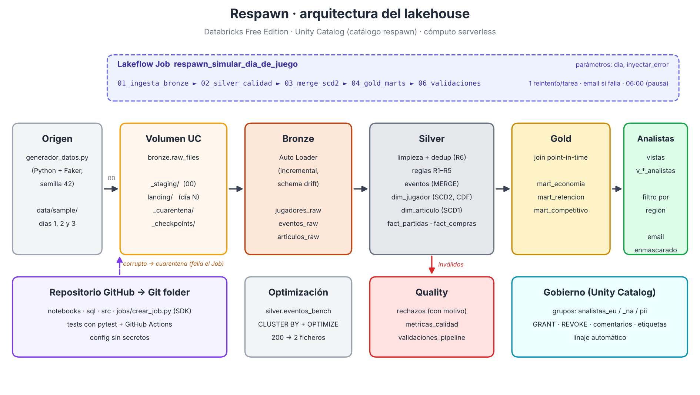
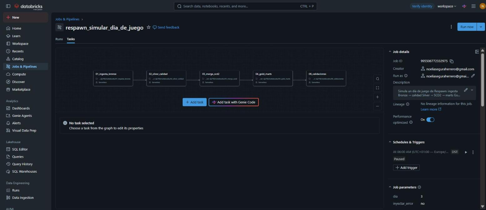
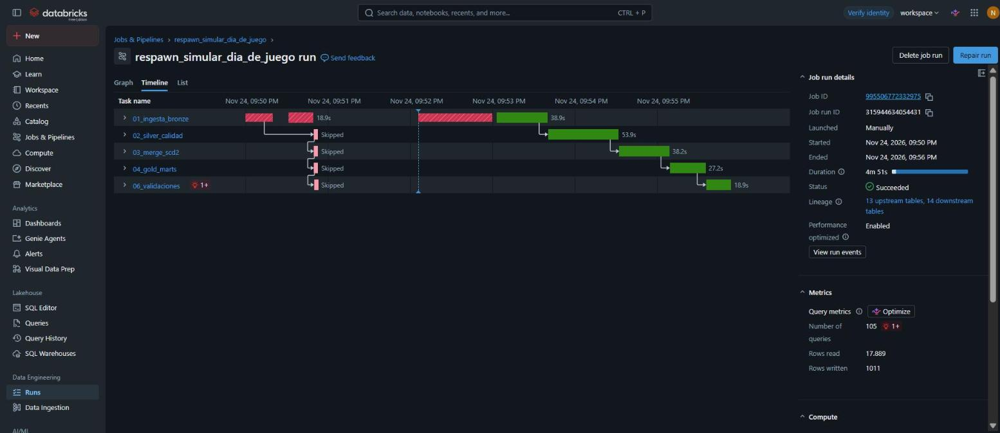
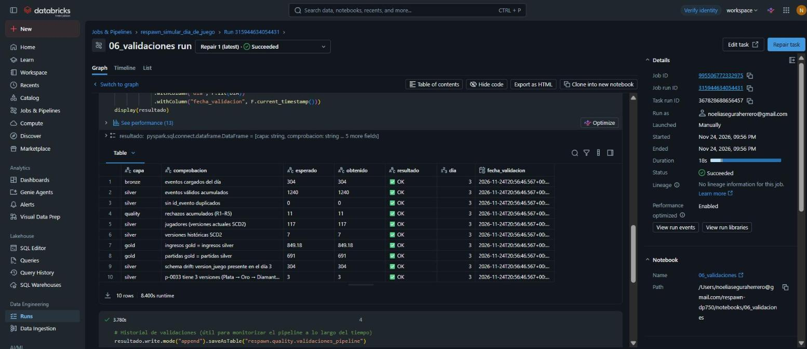

# Respawn — Lakehouse de un videojuego en Databricks

Proyecto final de la certificación **DP-750 (Azure Databricks Data Engineer Associate)**.
Todo está montado en **Databricks Free Edition** con datos sintéticos generados con Python.

---

## 1. Descripción

### El problema
*Respawn* es un videojuego online inventado, con jugadores en Europa (EU) y Norteamérica (NA). Cada día el juego
deja ficheros con lo que ha pasado: inicios de sesión, partidas, compras en la tienda y subidas de rango.

Esos datos no llegan limpios. Hay eventos duplicados por reconexiones, registros sin identificador, fechas que están
en el futuro, compras con precios que no existen y, sobre todo, **tramposos**: jugadores con puntuaciones imposibles
para lo que ha durado la partida. Si se analizan los datos tal cual, los informes de ventas y los rankings salen mal.

### La solución
He construido un lakehouse en Unity Catalog con arquitectura medallón (Bronze → Silver → Gold) que:

- Carga los ficheros de cada día de forma **incremental** con Auto Loader.
- Pasa todos los eventos por un **"detector de tramposos"** (6 reglas de calidad). Lo que no cumple las reglas no se
  borra: se guarda aparte con el motivo.
- Guarda el **historial de rangos** de cada jugador (SCD tipo 2), para saber qué rango tenía cuando hizo cada compra.
- Publica **3 data marts** para negocio: economía, retención y ranking competitivo.
- Protege los datos personales (email) y filtra por región según el grupo del analista.
- Se ejecuta con un **Lakeflow Job** que simula "un día de juego", con reintentos, aviso por email y una
  validación final que comprueba que todo cuadra.

### Resultado
Después de procesar los 3 días: **1.240 eventos válidos**, **11 rechazados** con su motivo, **15 duplicados**
eliminados, **117 jugadores** con **7 cambios de rango** guardados en el historial, **691 partidas** y **849,18 €** en ventas.
Las **10 validaciones** del pipeline salen correctas y los **19 tests** automáticos pasan.

---

## 2. Arquitectura



Recorrido de los datos:

1. **Origen.** El generador (`src/generador_datos.py`) crea los ficheros de 3 días en `data/sample/`. El notebook `00`
   los copia al volumen de Unity Catalog `/Volumes/respawn/bronze/raw_files/_staging/`.
2. **Llegada del día.** La tarea 01 del Job "publica" el día N copiándolo a `landing/`, como si el juego acabara de
   dejar los ficheros. Si encuentra un JSON corrupto, lo mueve a `_cuarentena/` y para el Job.
3. **Bronze.** Auto Loader lee solo los ficheros nuevos y los guarda tal cual en tablas Delta, añadiendo de qué fichero
   viene cada fila y cuándo se cargó.
4. **Silver.** Limpio y tipo los datos, quito duplicados, aplico las reglas de calidad y separo lo válido de lo
   rechazado. Los jugadores van a una dimensión SCD2.
5. **Gold.** Construyo los 3 data marts a partir de Silver. Los analistas no leen las tablas directamente, sino unas
   vistas que filtran por región y enmascaran el email.
6. **Validación.** La última tarea compara cada capa con lo que el generador dice que debería haber y deja el resultado
   en `quality.validaciones_pipeline`.

---

## 3. Tecnologías

| Tecnología | Para qué la uso |
|---|---|
| Databricks Free Edition (cómputo serverless) | Ejecutar los notebooks y el Job |
| Unity Catalog | Catálogo, esquemas, volumen, permisos, etiquetas y linaje |
| Delta Lake | Todas las tablas: MERGE, historial de versiones, time travel, Change Data Feed |
| Auto Loader (`cloudFiles`) | Ingesta incremental y evolución del esquema |
| PySpark y Spark SQL | Transformaciones y consultas |
| Lakeflow Jobs + Databricks SDK | Orquestación (el Job se crea desde código) |
| Python y Faker | Generar los datos sintéticos |
| pytest + GitHub Actions | Tests automáticos en cada push |
| Git / GitHub + Git folder de Databricks | Control de versiones |

---

## 4. Instalación y configuración

### Lo que necesitas
- Una cuenta de **Databricks Free Edition** (o un workspace con Unity Catalog y cómputo serverless).
- Permiso para crear catálogos (en Free Edition lo tienes por defecto).
- Para los tests en local (opcional): Python 3.11 y Java 17.

No hace falta ninguna contraseña, token ni clave. El repositorio no contiene secretos.

### Paso a paso

**1. Traer el repositorio a Databricks.**
`Workspace → Create → Git folder` y pegar la URL del repositorio. Así los notebooks y los datos de ejemplo
quedan dentro del workspace.

**2. Crear el catálogo, los esquemas y el volumen.**
Abrir `sql/01_catalogo_y_esquemas.sql` y ejecutarlo. Crea el catálogo `respawn`, los esquemas `bronze`, `silver`,
`quality` y `gold`, y el volumen gestionado `respawn.bronze.raw_files`.

**3. Copiar los datos al volumen.**
Ejecutar `notebooks/00_preparar_volumen.py`. Copia `data/sample/` a `/Volumes/respawn/bronze/raw_files/_staging/`.

**4. Crear el Job.**
Ejecutar `jobs/crear_job.py`. Crea (o actualiza, si ya existe) el Job `respawn_simular_dia_de_juego`. La programación
diaria se queda **en pausa** para que no gaste recursos.

**5. Simular los días de juego.**
En `Jobs & Pipelines → respawn_simular_dia_de_juego → Run now with different parameters`, lanzar el Job tres veces
cambiando el parámetro `dia`:

| Ejecución | `dia` | `inyectar_error` | Qué se ve |
|---|---|---|---|
| 1 | 1 | no | Carga inicial |
| 2 | 2 | no | Duplicados, tramposos y cambios de rango (MERGE y SCD2) |
| 3 | 3 | si | El Job falla por el fichero corrupto, que se mueve a cuarentena. Después, **Repair run** cambiando `inyectar_error` a `no`: termina bien y aparece la columna nueva `version_juego` |

**6. Seguridad.**
Primero hay que crear a mano tres grupos en `Settings → Identity and access → Groups` (pueden estar vacíos):
`respawn_analistas_eu`, `respawn_analistas_na` y `respawn_pii`. Después, ejecutar
`notebooks/05_seguridad_gobierno.py`, que crea las funciones de filtro y máscara, las vistas para analistas, los
permisos y las etiquetas.

**7. Optimización (opcional).**
`notebooks/07_optimizacion.py` crea una tabla de pruebas de 10 millones de filas y mide antes y después de aplicar
clustering y OPTIMIZE. Al terminar se puede borrar con `DROP TABLE respawn.silver.eventos_bench`.

**Volver a empezar:** `notebooks/99_reiniciar_entorno.py` borra las tablas, los checkpoints y `landing/` para repetir
la simulación desde el día 1.

### Lo que hay que hacer a mano (no se puede guardar en Git)
- Crear el Git folder (paso 1).
- Crear los tres grupos (paso 6).
- Cambiar la pertenencia a los grupos para probar la seguridad con otro perfil.

### Tests en local
```bash
pip install -r requirements.txt
python -m pytest tests -v
```
Los tests también se ejecutan solos en GitHub Actions con cada push (`.github/workflows/tests.yml`).

---

## 5. Datos y modelo

### Fuentes
Todas son sintéticas y las genera `src/generador_datos.py` con la semilla 42, así que siempre salen iguales.
Los emails son ficticios (`@example.com`).

| Fichero | Formato | Contenido |
|---|---|---|
| `jugadores_dia_N.csv` | CSV | Altas y cambios de jugadores (país, región, rango, nivel…) |
| `eventos_dia_N.json` | JSON Lines | Eventos de juego con un campo anidado `detalle` |
| `articulos.csv` | CSV | Catálogo de la tienda (12 artículos con su precio) |
| `errores/eventos_corrupto.json` | JSON roto | Sirve para provocar el error del Job |

Los errores están metidos a propósito y apuntados en `data/sample/resumen_esperado.json`:

| Día | Qué trae |
|---|---|
| 1 | 100 jugadores y 538 eventos limpios |
| 2 | 12 jugadores nuevos, 5 que suben de rango, 15 eventos duplicados y 11 eventos con errores (3 de ellos, de tramposos) |
| 3 | 5 jugadores nuevos, 2 subidas de rango y una **columna nueva** (`version_juego`) |

### Capas y tablas (catálogo `respawn`)

| Esquema | Tabla | Qué guarda |
|---|---|---|
| bronze | `jugadores_raw`, `eventos_raw`, `articulos_raw` | Los datos tal como llegan, más el fichero de origen, la fecha de carga y `_rescued_data` |
| silver | `eventos` | Eventos limpios y sin duplicados |
| silver | `dim_jugador` | Jugadores con historial (SCD2): `fecha_inicio_vigencia`, `fecha_fin_vigencia`, `es_actual` |
| silver | `dim_articulo` | Catálogo de la tienda (SCD1) |
| silver | `fact_partidas`, `fact_compras` | Hechos de partidas y compras |
| silver | `control_cargas` | Qué versión de Delta corresponde a cada día (para el time travel) |
| quality | `rechazos` | Eventos que no cumplen alguna regla, con el motivo |
| quality | `metricas_calidad` | Recuentos de cada carga: leídos, válidos, rechazados por regla y duplicados |
| quality | `validaciones_pipeline` | Historial de las validaciones de extremo a extremo |
| gold | `mart_economia` | Ventas por día, región, categoría y rango que tenía el comprador |
| gold | `mart_retencion` | Jugadores activos, nuevos y que vuelven, por día |
| gold | `mart_competitivo` | Ranking de jugadores |
| gold | `v_jugadores_analistas`, `v_economia_analistas`, `v_competitivo_analistas` | Vistas para analistas (filtro por región y email enmascarado) |

Todas las tablas son **gestionadas** (*managed*): Unity Catalog se encarga del almacenamiento y de borrar los ficheros
si se borra la tabla. En Free Edition no hay un almacenamiento externo propio que justifique usar tablas externas.

### Reglas de calidad (el "detector de tramposos")

| Regla | Qué comprueba |
|---|---|
| R1 | `id_evento` e `id_jugador` no pueden ser nulos |
| R2 | La fecha del evento no puede estar en el futuro |
| R3 | Puntuación ≤ duración en segundos × 5 y bajas ≤ 60 (si no, es un tramposo) |
| R4 | Una compra tiene que tener importe positivo e igual al precio del artículo |
| R5 | El jugador tiene que existir |
| R6 | Un solo registro por `id_evento` (los duplicados se quitan y se cuentan) |

Las reglas R1–R5 están en `src/reglas_calidad.py` para poder probarlas con pytest fuera de Databricks.

---

## 6. Ejemplos de ejecución

### El Job
```
01_ingesta_bronze ─► 02_silver_calidad ─► 03_merge_scd2 ─► 04_gold_marts ─► 06_validaciones
```
Tiene los parámetros `dia` (1, 2, 3) e `inyectar_error` (no/si), un reintento por tarea (menos la validación final), aviso por email si falla y una
ejecución programada a las 06:00 (en pausa). Más detalle en [`jobs/configuracion.md`](jobs/configuracion.md).



**Error y recuperación.** Con `inyectar_error=si`, la tarea 01 encuentra el fichero corrupto, lo manda a cuarentena y
falla. El resto de tareas no se ejecuta, así que no se carga nada a medias. Para recuperarlo se hace **Repair run** cambiando antes
el parámetro `inyectar_error` a `no`: solo se repiten las tareas que no terminaron y el Job acaba bien. Hay que cambiarlo porque,
con `si`, la tarea 01 volvería a dejar el fichero corrupto en `landing/` y fallaría otra vez.



### Consultas para comprobar los resultados

```sql
-- ¿Por qué se ha rechazado cada evento? (día 2: 2 + 2 + 3 + 2 + 2 = 11)
SELECT motivo, count(*) FROM respawn.quality.rechazos GROUP BY motivo;

-- Los tramposos detectados (esperados: p-0007, p-0022 y p-0051)
SELECT DISTINCT id_jugador FROM respawn.quality.rechazos WHERE motivo = 'R3_puntuacion_imposible';

-- Historial de rangos de p-0033: 3 versiones
SELECT id_jugador, rango, fecha_inicio_vigencia, fecha_fin_vigencia, es_actual
FROM respawn.silver.dim_jugador WHERE id_jugador = 'p-0033' ORDER BY fecha_inicio_vigencia;

-- Qué versión de Delta corresponde a cada día, para consultarla con VERSION AS OF
SELECT * FROM respawn.silver.control_cargas ORDER BY dia;

-- Resultado de las últimas validaciones
SELECT * FROM respawn.quality.validaciones_pipeline ORDER BY fecha_validacion DESC LIMIT 10;
```

### Resultados esperados tras el día 3

| Comprobación | Valor |
|---|---|
| Eventos válidos en Silver | 1.240 |
| Eventos rechazados | 11 |
| Duplicados eliminados | 15 |
| Jugadores (versión actual) | 117 |
| Versiones históricas (cambios de rango) | 7 |
| Partidas | 691 |
| Ingresos | 849,18 € |
| Validaciones del pipeline | 10/10 OK |
| Tests (pytest) | 19 passed |



### Seguridad
Como en Free Edition solo hay un usuario, comprobé la seguridad metiéndome y sacándome de los grupos y consultando la
misma vista en cada caso:

| Escenario | Qué se ve en `v_jugadores_analistas` |
|---|---|
| A. Sin ningún grupo (soy la propietaria) | Todas las regiones, con el email enmascarado |
| B. En `respawn_analistas_eu` | Solo jugadores de EU, con el email enmascarado |
| C. En `respawn_analistas_eu` y `respawn_pii` | Jugadores de EU con el email completo |

### Optimización
Usé una tabla de pruebas de 10 millones de filas escrita en 200 ficheros pequeños y le apliqué
`CLUSTER BY (id_jugador, fecha_evento)` y `OPTIMIZE`:

| | Antes | Después |
|---|---|---|
| Ficheros | 200 | 2 |
| Tamaño | 73,8 MB | 67,8 MB |
| Tiempo de la consulta | 0,91 s | 1,0 s |

Los ficheros se compactan, pero el tiempo no baja: con 74 MB lo que más pesa es arrancar la consulta en serverless,
no leer los datos. Está explicado con más detalle en [`docs/optimizacion_y_tests.md`](docs/optimizacion_y_tests.md).

Todas las capturas están en [`docs/capturas/`](docs/capturas/) (el prefijo `fN_` indica la fase).

---

## 7. Conclusiones

### Lo que he aprendido
- **Auto Loader** facilita mucho la carga incremental: gracias al checkpoint, aunque ejecute el Job dos veces no se
  cargan datos repetidos, y además añade solo las columnas nuevas.
- Con la técnica de **SCD2 en un solo MERGE** (*staged updates*) se cierra la versión antigua y se inserta la nueva en la
  misma operación. Tener el historial permite hacer el join *point-in-time*: cada compra se cuenta con el rango que
  tenía el jugador ese día, no con el que tiene ahora.
- Es mejor **no borrar** los datos malos y guardarlos con su motivo. Así se puede explicar cada número y comprobar que
  las reglas funcionan.
- Unity Catalog permite hacer la seguridad con **funciones y vistas**, sin duplicar datos por región.

### Dificultades y cómo las resolví
- **Modo ANSI de serverless.** Algunas operaciones que funcionan en local fallan en Databricks, como acceder a una
  posición que no existe en un array. Lo solucioné con `try_to_timestamp`, `try_divide` y comprobando el tamaño antes
  de usar `element_at`.
- **Git folder con repositorio privado.** Databricks Free no conseguía conectarse a GitHub con el repositorio privado,
  así que lo hice público (no contiene secretos).
- **Schema drift.** Cuando llega la columna nueva, Auto Loader para el stream a propósito para registrar el esquema
  nuevo. Reintentarlo dentro del notebook no bastaba, así que añadí un reintento a la tarea del Job.
- **Un solo usuario.** Para demostrar los permisos tuve que ir cambiando mi pertenencia a los grupos, y los cambios
  tardan unos minutos en aplicarse.
- **Datos de prueba de la optimización.** Al principio los generé con una fórmula que hacía que las columnas
  dependieran unas de otras, y la consulta no devolvía nada. Lo cambié por un hash con una semilla distinta para cada
  columna.

### Limitaciones
- El join *point-in-time* va por día: si un jugador sube de rango y compra el mismo día, se usa el rango del final del día.
- En serverless no se puede desactivar la caché, así que los tiempos medidos tienen algo de ruido.
- Los datos son pequeños. La optimización está medida, pero su beneficio real solo se notaría con mucho más volumen.

### Mejoras que haría
- Pasar el pipeline a **Lakeflow Declarative Pipelines**, con *expectations* para las reglas de calidad.
- Usar **Databricks Asset Bundles** para desplegar el Job y los notebooks en varios entornos (dev y prod).
- Montar un **dashboard** de Databricks SQL sobre los data marts y alertas sobre `metricas_calidad`.
- Generar más volumen y más días para medir la optimización con datos realistas.

---

## Estructura del repositorio

```
├── .github/workflows/   Tests automáticos en GitHub Actions
├── config/              Nombres del catálogo, esquemas y rutas (sin secretos)
├── data/sample/         Datos de ejemplo de los 3 días y resumen esperado
├── docs/                Diseño, arquitectura, informe, optimización, capturas y evidencias
├── jobs/                Script que crea el Job y su documentación
├── notebooks/           00 volumen · 01 Bronze · 02 Silver y calidad · 03 SCD2 · 04 Gold
│                        05 seguridad · 06 validaciones · 07 optimización · 99 reinicio
├── presentation/        Presentación del proyecto
├── sql/                 Catálogo, esquemas y volumen
├── src/                 Generador de datos y reglas de calidad
└── tests/               Tests con pytest
```
